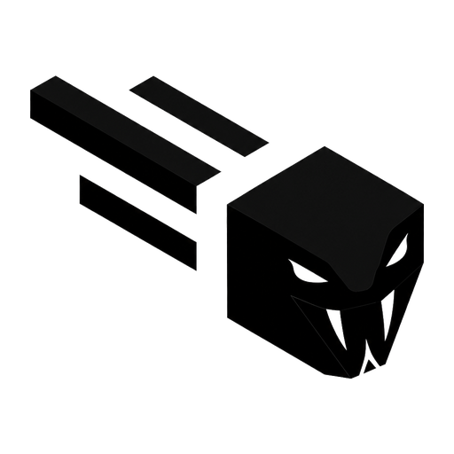

<p align="center">
  
</p>

<h1 align="center">Venomous</h1>
<p align="center">A feature-heavy Meteor Client addon for Minecraft 26.2.</p>

<div align="center">
    
    
    
    <br>
    
    
    
    
</div>

> **Status:** `WIP`
>
> This repository is a work in progress, and bugs are to be expected.
> If you encounter a problem, feel free to [open an issue](https://github.com/International-Duck-Incorporated/Venomous/issues).

## Overview

Venomous is an addon for **Meteor Client 26.2** that extends Meteor with a broad collection of modules covering combat, movement, exploits, detection, rendering, automation, and general utility.

It is designed to provide a large feature set from a single addon while remaining integrated with Meteor's existing module and configuration system.

## Features

### Combat

Combat-focused modules include:

* CrystalPvP
* VKillAura
* SuperKnockback
* MaceKill
* AutoPotion
* Aimbot
* AutoClickerPlus
* And more

### Exploits & Anticheat

Modules focused on server-side behaviour, networking, and anticheat-related functionality include:

* Disabler
* VBungeeCordSpoof
* PingSpoof
* TimeShift
* VChorusExploit
* VPortalGodMode
* And more

### Movement

Movement and positioning modules include:

* Fly
* Speed
* Phase
* Clip
* VBlink
* VBoatPhase
* AssertDominance
* NoPush
* And more

### Detection

Detection and player-awareness modules include:

* AntiCheatDetect
* AntiStaff
* VAntiVanish
* SpectatorAlert
* VPlayerDetection

### ESP & Render

Rendering and world-information modules include:

* VNewChunks
* VSkeletonESP
* VLightESP
* VInvisESP
* AntiBlind

### Automation & Miscellaneous

Automation, inventory, and utility modules include:

* Scaffold
* VAutoFarm
* ItemOrganizer
* VBookBot
* VNotifier
* And more

## Compatibility

| Component     | Version  |
| ------------- | -------- |
| Minecraft     | **26.2** |
| Meteor Client | **26.2** |
| Java          | **25**   |

Venomous is a **Meteor Client addon**, not a standalone client.

A compatible installation of Meteor Client is required.

## Installation
* [Latest Nightly Build](https://github.com/International-Duck-Incorporated/Venomous/releases/download/nightly-2026.09.20-b6e6992/Venomous-7.0.0-nightly-2026.09.20%2Bb6e6992.jar)
1. Install a Fabric environment for Minecraft 26.2.
2. Install the matching Meteor Client version.
3. Download the Venomous `.jar`, or build it yourself.
4. Place the Venomous jar in your Minecraft `mods` directory.
5. Start Minecraft.
6. Open Meteor's module menu and enable the modules you want to use.

## Building

### Requirements

* Java 25
* Gradle
* Minecraft 26.2 development environment

### Linux / macOS

```bash
./gradlew build
```

### Windows

```powershell
.\gradlew.bat build
```

The compiled jar will be available in:

```text
build/libs/
```

## Development

Venomous is structured as a Fabric project and integrates directly with Meteor Client.

The repository currently contains:

```text
src/
├── main/
│   ├── java/
│   └── resources/
│       └── assets/
│           └── venomous/
│               └── icon.png
└── test/
```

The project uses Gradle Kotlin DSL for its build configuration.

## Issues & Bug Reports

Found a bug, crash, compatibility problem, or unexpected behaviour?

Open an issue in the [issue tracker](https://github.com/International-Duck-Incorporated/Venomous/issues).

Please include as much relevant information as possible:

* Minecraft version
* Meteor Client version
* Venomous version or commit
* Java version
* Operating system
* Relevant crash log or stack trace
* Steps to reproduce the problem

This makes issues substantially easier to diagnose and reproduce.

## Contributions

Pull requests are welcome.

When contributing:

* Keep changes focused.
* Follow the existing project structure.
* Prefer readable and maintainable code.
* Avoid committing IDE-specific or generated files.
* Test changes against the supported Minecraft and Meteor versions where possible.
* Include useful context in pull requests describing what changed and why.

## Credits

Venomous is built as an addon for [Meteor Client](https://github.com/MeteorDevelopment/meteor-client).

Thanks to the [Fabric](https://fabricmc.net/) project and its contributors for the modding ecosystem Venomous is built on.

Additional libraries, projects, and upstream code are credited in the relevant source files where applicable.

## Disclaimer

Venomous is provided for educational and experimental purposes.

Server owners and network operators may prohibit the use of certain modules or modifications. Always follow the rules of the server you are playing on.

## License

The repository currently does **not declare an explicit license**.

Until a license is added to the repository, the source should not be assumed to be available under an open-source license or for unrestricted redistribution.

## Links

* [GitHub Repository](https://github.com/International-Duck-Incorporated/Venomous)
* [Issue Tracker](https://github.com/International-Duck-Incorporated/Venomous/issues)
* [Meteor Client](https://github.com/MeteorDevelopment/meteor-client)
